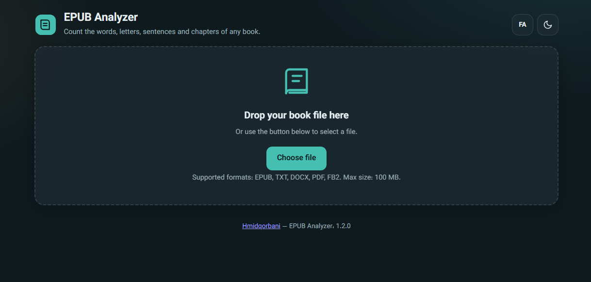
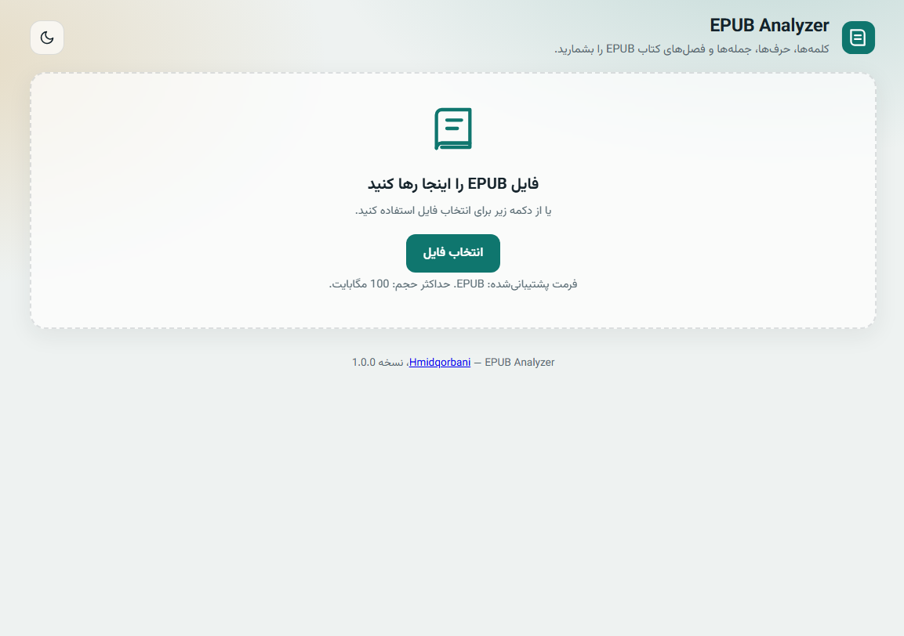
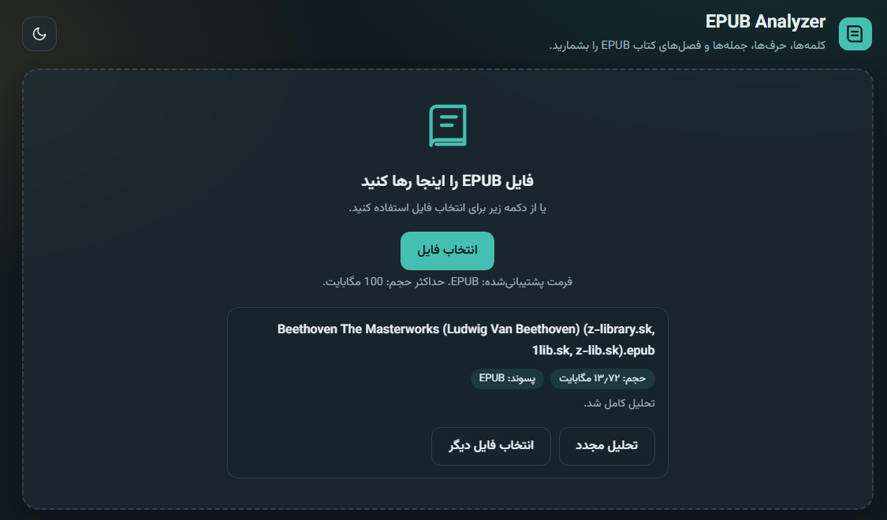
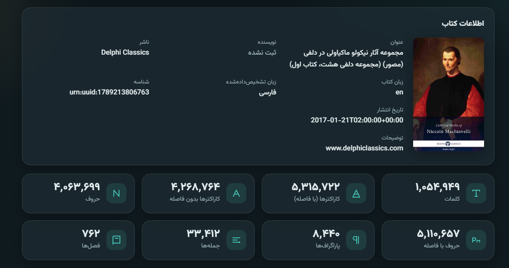
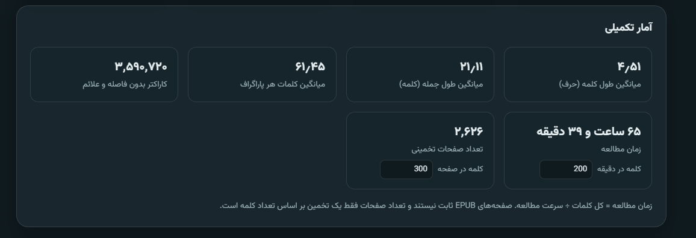
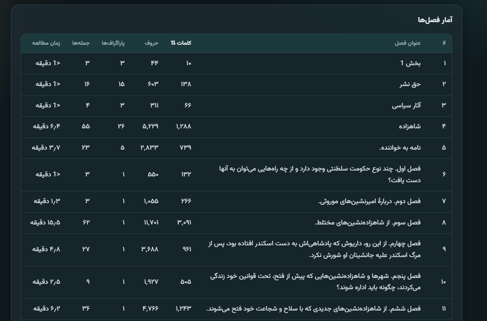

<div align="center">


# EPUB Analyzer

**Count the words, letters, sentences and chapters of any book (EPUB, TXT, DOCX, PDF, FB2).**
<br>
**کلمه‌ها، حرف‌ها، جمله‌ها و فصل‌های هر کتاب (EPUB، TXT، DOCX، PDF، FB2) را بشمارید.**


[English](#english) · [فارسی](#فارسی)

</div>

## Screenshots · تصاویر

<p align="center">
  
  
</p>

<p align="center">
  
</p>
<p align="center">
  
</p>
<p align="center">
  
</p>
<p align="center">
  
</p>

---

<a id="فارسی"></a>
<br>
<br>
<br>
<br>
<div dir="rtl">

## معرفی

### EPUB Analyzer
ابزاری سبک است که فایل کتاب را کاملاً در حافظه می‌خواند و آمار دقیق متن آن را نشان می‌دهد: کلمه، حرف، کاراکتر، پاراگراف، جمله، فصل، آمار هر فصل، متادیتا، جلد، زبان تشخیص‌داده‌شده، زمان مطالعه (کل و هر فصل) و تعداد صفحات تخمینی. فرمت‌های پشتیبانی‌شده: **EPUB، TXT، DOCX، PDF، FB2**. فارسی، عربی، انگلیسی و زبان‌های لاتین پشتیبانی می‌شوند. کل برنامه (Backend با FastAPI و Frontend با HTML/CSS/JS) در یک فایل `main.py` است و می‌توان آن را به‌صورت اپ دسکتاپ ویندوز هم بسته‌بندی کرد.

## ویژگی‌ها

- **پنج فرمت کتاب:** EPUB، TXT، DOCX، PDF، FB2
- **رابط دوزبانه (فارسی/انگلیسی)** با تشخیص خودکار زبان مرورگر و ذخیره در LocalStorage
- آپلود با Drag & Drop یا انتخاب فایل، همراه با نمایش نام، حجم، پسوند و وضعیت پردازش
- **نمایش جلد کتاب** برای فایل‌های EPUB (با سه روش تشخیص)
- **تشخیص خودکار زبان محتوا** (فارسی، عربی، انگلیسی، روسی، چینی) بر اساس اسکریپت غالب
- اعتبارسنجی ساختار داخلی EPUB (ZIP، `container.xml`، mimetype، DRM/رمزگذاری، ZIP Bomb، مسیرهای مخرب)
- پردازش فقط در حافظه؛ هیچ فایلی روی دیسک ذخیره نمی‌شود
- Navigation، فهرست مطالب، جلد و صفحه‌های تکراری در شمارش‌ها لحاظ نمی‌شوند
- متادیتا: عنوان، نویسنده، ناشر، زبان، شناسه، تاریخ انتشار، توضیحات
- آمار تکمیلی: میانگین طول کلمه، جمله و پاراگراف، زمان مطالعه (پیش‌فرض ۲۰۰ کلمه در دقیقه) و تعداد صفحات تخمینی (پیش‌فرض ۳۰۰ کلمه در صفحه) که هر دو در رابط کاربری قابل تغییرند
- **زمان مطالعه به‌تفکیک هر فصل**
- **فصل‌بندی دقیق‌تر:** تقسیم فایل‌های چندفصلی بر اساس Anchorهای TOC و در نبود TOC بر اساس تیترهای داخل فایل
- جدول Responsive آمار فصل‌ها با قابلیت مرتب‌سازی
- تم روشن و تیره (ذخیره در LocalStorage)
- مستندات Swagger در `/docs`

## ساختار پروژه

```text
epub-analyzer/
├── main.py            # Backend + Frontend (FastAPI)
├── gui.py             # اپ دسکتاپ ویندوز (pywebview)
├── installer.iss      # اسکریپت Inno Setup
├── icon.ico           # آیکون برنامه
├── requirements.txt
├── README.md
└── docs/              # لوگو و تصاویر